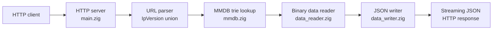

# GeoIP2-zig

[](https://ziglang.org/)
[](LICENSE)

A hand-rolled implementation of the MaxMind GeoIP2 binary format in Zig. No external dependencies for the core MMDB logic — just Zig's standard library and a 40MB embedded database. The HTTP server runs on [zio](https://github.com/lalinsky/zio), an evented I/O runtime implementing Zig 0.17's `std.Io` interface (kqueue/io_uring/epoll). The project explores low-level systems programming: binary protocol parsing, Patricia trie traversal, and evented I/O with fixed-size memory.

**Performance: ~150K requests/second** with p99 latency under 4ms at 256 concurrent connections. Load test results are published in every CI run's job summary.

## Quick Start

```shell
zig build
./zig-out/bin/geoip-zig
curl http://127.0.0.1:8080/ipv4/8.8.8.8
```

## What It Demonstrates

| Skill | Where it shows up |
|-------|-----------------|
| Binary protocol parsing | `mmdb/data_reader.zig` — bit-level decoding of MaxMind's custom binary format |
| Patricia trie traversal | `mmdb/mmdb.zig` — zero-allocation trie walk for IP lookup |
| Streaming JSON serialization | `mmdb/data_writer.zig` — direct binary-to-JSON without intermediate representation |
| Evented I/O | `src/main.zig` — zio runtime (kqueue) with a fiber per connection via `Io.Group` |
| Fixed-size memory | 2 MiB static runtime heap + 256 preallocated connection slots; no heap growth under load |
| Explicit memory management | Fixed-buffer allocator for parsing; embedded database avoids runtime file I/O |
| Graceful shutdown | `src/main.zig` — `zio.Signal` + `select` on SIGTERM/SIGINT, cancel accept fiber, drop idle keep-alives |

## Architecture



## Building

```shell
zig build
```

> **Note:** If you create a `GeoIP.conf` file for the `download-mmdb` tool, never commit it. Prefer setting `MAXMIND_LICENSE_KEY` as an environment variable instead.

Run with defaults (`127.0.0.1:8080`) or override:

```shell
./zig-out/bin/geoip-zig --port 9000
```

## Testing

```shell
./run_tests.sh
```

Unit tests only:

```shell
zig build test
```

## API

```
GET /ipv4/8.8.8.8
GET /ipv6/2001:4860:4860::8888
```

Response:

```json
{
  "country": { "iso_code": "US", "names": { "en": "United States" } },
  "city": { "names": { "en": "Mountain View" } },
  "location": { "latitude": 37.4223, "longitude": -122.0848, "time_zone": "America/Los_Angeles" }
}
```

Status codes: `200` lookup result, `204` favicon, `400` bad target, IP format, or request body (all endpoints are GET-only), `404` IP not in database, `431` request head over the 8 KiB cap, `503` connection pool full.

## Benchmarks

Original (`Io.Threaded`, blocking) vs this branch (zio evented, keep-alive, fixed memory).
Same workload: mixed IPv4/IPv6 lookups, 8 s `wrk` runs, Apple Silicon, ReleaseSafe.

| Concurrency | | rps | p50 | p90 | p99 |
|---|---|---|---|---|---|
| c=1 | original | 14.7K | 26µs | 29µs | 15.7ms |
| | **zio** | **28.1K** | 33µs | 37µs | **50µs** |
| c=10 | original | 32.5K | 97µs | 128µs | 66ms |
| | **zio** | **97.9K** | 73µs | 110µs | **154µs** |
| c=50 | original | 32.0K | 646µs | 797µs | 77ms |
| | **zio** | **147.7K** | 279µs | 543µs | **0.90ms** |
| c=100 | original | 30.3K | 1.34ms | 1.69ms | 55ms |
| | **zio** | **152.5K** | 566µs | 1.04ms | **1.56ms** |
| c=256 | original | 30.2K | 3.93ms | 4.62ms | 63ms |
| | **zio** | **154.5K** | 1.57ms | 2.38ms | **3.32ms** |

The original degrades past c=10 because one thread serializes all blocking syscalls;
its p99 sits at 15–66 ms at every concurrency level. zio scales flat and keeps the
tail under 4 ms. Cost: ~3x CPU per request (fiber scheduling, event loop) and 5.1
cores of CPU at saturation, in 15 fixed threads, 6 MiB of static memory, 0% errors.

## Project Structure

```
src/
├── main.zig              # entry point, evented HTTP server, connection slots
├── mmdb/
│   ├── mmdb.zig         # MMDB file loader, trie traversal, lookup API
│   ├── data_reader.zig  # binary format parser (pointers, maps, strings, integers)
│   ├── data_writer.zig  # binary-to-JSON serialization
│   └── metadata.zig     # database metadata parser
```

## The Code

The interesting files to read:

- **`data_reader.zig`** — Shows how to decode a real binary format byte-by-byte: variable-length encoding, pointer resolution, bit-level operations.
- **`mmdb.zig`** — The Patricia trie search. Walks 128 bits of an IP address through a precomputed binary trie. No heap allocations after startup.
- **`main.zig`** — Evented I/O with fixed memory. One fiber per connection via `Io.Group`, served from 256 preallocated slots; excess connections get 503 without allocating anything. The request buffer size doubles as the HTTP head cap. Streaming JSON response written directly to the socket buffer.

## License

GPLv3 License. See the [LICENSE](LICENSE) file and the [NOTICE](NOTICE) file for MaxMind database attribution requirements.
